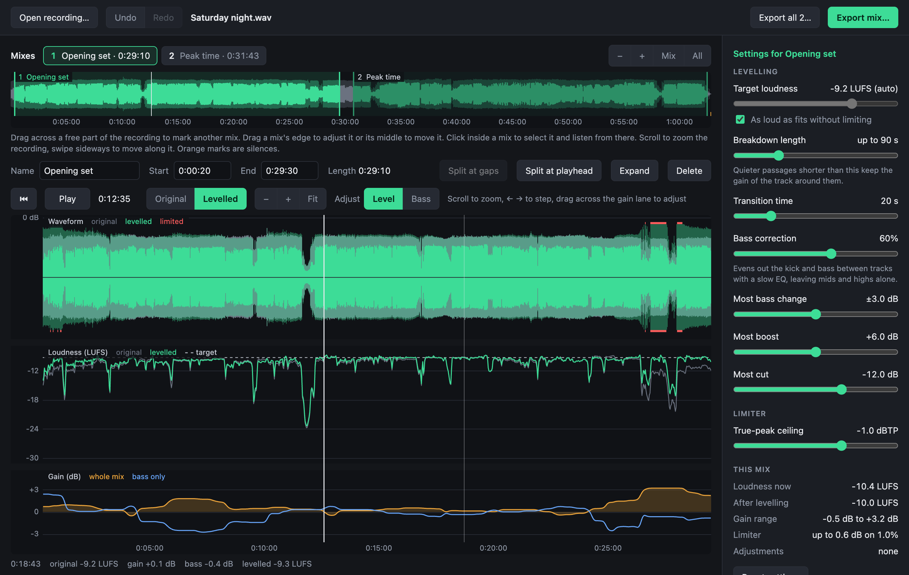

# DJ Mix Master

[](https://github.com/Suva/djmixmaster/actions/workflows/test.yml)

Masters recorded DJ mixes. Open a long recording, mark the mix inside it, and
the tool evens out the loudness from track to track: louder tracks are turned
down and quieter ones up, while breakdowns keep their natural dip instead of
being pumped up.

It comes as a desktop app for macOS and Windows, and as a command-line tool
that shares the same processing.



## Download and install

Installers are on the [releases page](https://github.com/Suva/djmixmaster/releases). What changed in each
release is in [CHANGELOG.md](CHANGELOG.md), and on the website's
[What's new](https://suva.github.io/djmixmaster/changes.html) page.
Nothing else needs to be installed; the app carries everything it uses.

| System | File | Needs |
|---|---|---|
| macOS | `DJ.Mix.Master-…-arm64.dmg` | A Mac with Apple Silicon (M1 or later), macOS 13 or later |
| Windows | `DJ.Mix.Master.Setup.….exe` | 64-bit Windows 10 or later |
| Linux | `DJ.Mix.Master-….AppImage` | 64-bit Linux on an Intel or AMD processor |

The installers are not signed, so both systems warn about them the first time.

- **macOS**: open the disk image and drag the app to Applications. The first
  launch is blocked. Open System Settings → Privacy & Security, scroll down
  and click "Open Anyway". After that it opens normally. If macOS says the
  app is damaged, run
  `xattr -dr com.apple.quarantine "/Applications/DJ Mix Master.app"`
  in Terminal.
- **Windows**: run the setup file. When "Windows protected your PC" appears,
  click "More info" and then "Run anyway".

- **Linux**: make the file executable (in a terminal, `chmod +x DJ*.AppImage`,
  or under Properties → Permissions in a file manager) and run it. If nothing
  happens, the system lacks FUSE 2, which AppImages need: on Ubuntu 24.04 that
  is `sudo apt install libfuse2t64`, on older Ubuntu `libfuse2`.

There is no build for Intel Macs yet. On those, the tool can be run
[from source](#running-from-source).

## Getting started

1. **Open a recording.** Drop a file on the window or use "Open recording…".
   It is analysed once, which takes a little over a minute for an eight-hour
   file. A button next to the file name then says whether anything is wrong
   with the recording itself.
   A recorder that splits long recordings into several files (often at 2 or
   4 GB) is no problem: select all the parts, or drop them together, and they
   open as one recording. Parts numbered by the recorder are joined in the
   order of their numbers; others in the order they were written.
   A video of the set (MP4, MOV, MKV or WebM) opens like a recording: its
   sound is mastered, and its picture can go with the export.
2. **Mark the mix.** The whole recording starts out as one mix. Drag its edges
   in, or press "Split at gaps" to cut a night apart at the silences. Drag
   across a free part to mark another mix.
3. **Listen.** Press Space to play. The bypass button, left of the
   play controls (or the A key), compares before and after. While it is on,
   it pulses, and the settings say that nothing they change is heard.
4. **Adjust if needed.** The defaults work for most mixes. The sliders on the
   right change how it levels; what you hear follows immediately.
5. **Export.** "Export mix…" writes the selected mix, "Export all" every mix
   into one folder.

Your recording is never changed and never leaves your computer. The only
thing the app contacts is GitHub, at most once a day, to see whether a newer
version exists. If there is one, a line in the header says so; nothing is
installed for you. Turn the check off under Help → Check for Updates
Automatically.

## What it does

- **Levels track against track, not moment against moment.** A slow gain curve
  follows how loud each track is at full energy. Quiet passages shorter than
  about 90 seconds are treated as breakdowns and keep the gain of the track
  around them.
- **Optional bass correction.** Kick and bass can be levelled separately from
  everything above them with a slowly moving low-shelf EQ, so the low end stays
  consistent without dragging the mids and highs along.
- **Leaves headroom by default.** With no target set, the result is made as
  loud as fits under the ceiling without leaning on the limiter. A higher
  target pushes into the limiter for more level.
- **Look-ahead true-peak limiter** on the output, with the ceiling at -1 dBTP by
  default. It holds the level between samples as well as on them.
- **Handles long files.** Recordings are streamed, never loaded whole.

## Using the app

### The recording and its mixes

- **Overview**: the whole recording. Drag across a free part to mark a mix,
  or double-click it to fill it with one;
  drag an edge to adjust it, drag the middle to move it. Scroll to zoom, swipe
  sideways to move.
- **Finding the sets**: silences in the recording are marked in orange. "Split
  at gaps" cuts a mix apart at them; "Split at playhead" is for handovers that
  were mixed without a gap.
- **Several mixes per recording**: each has its own name, settings and
  adjustments. Double-click a mix's tab to rename it. "Apply to all mixes"
  copies the selected mix's settings to the others.

### The check-up

After analysis, a button next to the file name reads "Nothing unusual found"
or "2 things to know". It opens a short report on the recording as it is:

- how much of it is clipped, and where;
- one channel quieter than the other, silent, or out of phase with it;
- a mono recording;
- very short gaps that may be dropouts from the recorder;
- a recording made very quietly;
- the sharp upper edge that MP3 or similar encoding leaves, also in a file
  that is lossless now;
- mains hum, at 50 or 60 Hz, told apart from a bass note by its exact pitch
  and its harmonics;
- rumble below anything musical, and a waveform that sits off centre;
- the format, sample rate, length, loudness and peak level.

Clipping is marked in red along the top of the overview and possible
dropouts in white. The report describes; it does not repair yet.

### Listening and adjusting

- **Detail view**: the waveform, the loudness before and after, and the gain
  being applied. Scroll to zoom in on a transition.
- **Transport**: the buttons above the curves jump to the start, step back,
  play or pause, step forward, and jump to the end. Holding back or forward
  keeps stepping.
- **Zooming in**: scroll over the curves to zoom, down to half a second across
  the window. From 20 seconds inwards the waveform is drawn from the sound
  itself, so single beats and bass notes can be seen. The start and end of a
  mix, and a split, land on the playhead to the millisecond.
- **Live preview**: settings change what you hear immediately, and the preview
  uses the same limiter as the export.
- **Level meter**: beside the curves, two columns of lights show what reaches
  the left and right speaker, turning red above your ceiling. A thinner column
  lights from the top as the limiter works, and a lamp lights when the
  recording itself is clipped at that moment. Underneath are the loudness at
  the playhead and the gain and bass change being applied there.
- **Adjusting by hand**: drag sideways across the gain lane to mark a stretch,
  then drag it up or down. The switch in the corner of the gain lane (Level or
  Bass) chooses whether a new stretch changes the whole sound or the bass only. Drag an edge to resize
  it, double-click to remove it.
- **Fades**: each end of a mix has a small square handle near the top of the
  waveform. Drag it inwards to fade in or out over that length; drag it back to
  the corner to remove the fade.
- **Undo and redo** cover every change to the mixes.
- **Your work is remembered**: mixes, settings and adjustments are saved per
  recording and restored when you open it again, also after the file has
  been moved or renamed. The app starts with the
  recording you had open last, if it is still where it was; earlier ones are
  listed on the start screen and under File > Open Recent. File > Close Recording puts the recording away,
  and the app then starts empty next time.

### The settings

| Setting | What it does |
|---|---|
| Even out tracks, Fixed gain | Whether the gain follows the tracks, or the whole mix is turned up or down by one amount, as on a mixer. With a fixed gain the settings for evening out tracks are put away; Loudness, hand adjustments, fades and the limiter work as before, and choosing Custom sets the gain in dB. |
| Loudness | How loud the result is. "As loud as fits" picks the highest level that keeps the limiter out of the way. The presets aim the whole mix at a level: Loud (-9 LUFS) for places that play the file as it is, Streaming (-14), Podcast or radio show (-16) and Broadcast (-23). Moving the slider sets the level of the full-energy parts by hand. |
| Breakdown length | Quieter passages shorter than this keep the gain of the track around them. Longer ones are treated as a quieter track and raised. |
| Transition time | How long a change of gain takes between two tracks. |
| Bass correction | How much of the difference in bass between tracks is evened out. Off by default. |
| Most bass change | The limit on that correction for any one track. |
| Most boost, Most cut | How far a quiet track may be raised and a loud one lowered. |
| True-peak ceiling | The highest level the output may reach. |

### Keys

The **?** button in the header, and Help → Gestures and Shortcuts, show
everything below together with the mouse and trackpad gestures.

| Key | Does |
|---|---|
| Space | Play or pause. Playback stops at the end of the mix; pressing play there starts the mix over |
| A | Bypass processing, to hear the recording as it is, and back |
| ← → | Move the playhead 5 seconds (30 with Shift, 1 with Option or Alt) |
| I, O | Put the start, or the end, of the mix at the playhead |
| Cmd/Ctrl+E | Split the mix at the playhead |
| M | Mark a track starting at the playhead |
| J, K, L | Run the playhead backwards, stop, run it forwards. Each further press of J or L doubles the speed, up to 8 times. Forwards plays sound up to 4 times the speed; backwards is silent |
| Return | Jump to the start of the mix |
| End | Jump to 10 seconds before the end of the mix |
| Cmd/Ctrl+Z, Shift+Cmd/Ctrl+Z | Undo, redo |
| Backspace or Delete | Delete the hand adjustment under the pointer, or else the track marker last clicked, or else the selected mix. The only mix goes back to covering the whole recording |
| Cmd/Ctrl+O | Open a recording |
| ? or F1 | Show the gestures and shortcuts |
| Shift+Cmd/Ctrl+W | Close the recording |
| Tab | Switch between the Mastering and the Video view |
| Esc | Cancel an analysis or export in progress |

### The tracks in a mix

Press **M** while the mix plays to mark where a track starts. Each marker shows
on the mix timeline with the track's name at the foot of the waveform: drag it
to move it, double-click the name to type one in (as *Artist - Title*), click
it to play from there, and Backspace removes the one last clicked.

The **Tracks** button beside the mix's artist lists them all, with their times
and names to edit, and can:

- **Import** a list from DJ software: a history or playlist exported as M3U8 or
  as text (rekordbox's, for one), or any list of names. Such a history says
  what was played, in order, but not when, so the tracks are spread evenly over
  the mix as a start, shown dashed until each has been dragged to where it
  really begins. A list with times, such as `12:30 Artist - Title` on each
  line, puts them at those times.
- **Paste** such a list from the clipboard.
- **Copy for YouTube**: the list with times, for the video's description,
  where YouTube turns it into chapters. It says if YouTube will not take it
  (it wants three tracks at least, each ten seconds or more).

The tracks become chapters in MP3, AAC and MP4 exports, which many players
show, and a video can show the track playing.

### A video for YouTube

YouTube will not take a mix as sound alone. The **Video** view (the switch at
the bottom of the window, or Tab) shows the selected mix as a video: a
template that moves to the music, with a few things to fill in, such as a
colour, a logo and the artist's name. Four templates come with the app:
Glitter, Spectrum ring, Waveform, and Photo, over a photo of your own. What is
chosen is kept with the mix.

You can also make templates of your own, in an editor beside the picture that
shows every change as it is made:

- **Layers** that draw (gradients, glitter, pictures, video clips, text, the
  spectrum, the waveform) and effects that change what is beneath them (glow, colour split,
  glitch, kaleidoscope, blur, brightness and contrast, hue and saturation),
  with blends as in an image editor, and **groups** to keep them together.
  Layers can be moved and resized on the picture itself.
- **Anything can follow the music**: pick what a setting moves with, such as
  the bass or the beat, and by how much; or write an expression, such as
  `100 + 8 * smooth(bass, 0.02, 0.4)`.
- **Fields**: what someone using the template fills in, such as a colour or a
  logo.
- **Video clips** loop, play once, or play forwards and backwards, at a
  speed you choose, and can start again on every beat, bar or track. A clip
  made on green or on black can have that keyed out. A video up to 25 MB is
  copied into the app's own folder when added; a larger one is used where it
  is, so it must stay there.
- **About**: who made the template and what it is.

Templates are shared as `.djmtemplate` files, with their pictures packed
inside: export one from the editor, and add one by importing it, dropping it
on the window, or opening it from Finder or Explorer. The templates that come
with the app stay as they are; editing one makes a copy of your own. A
template's website and email open in your own browser and mail program when
clicked; the app itself still contacts nothing.

Exporting a mix as **MP4 video** draws every frame of it at 1920 × 1080, 30
frames a second, with the sound in AAC. On an M1 Mac it takes about a sixth of
the mix's length with the templates that come with the app, some 20 minutes
for two hours; a template heavy with effects takes about three times as long.
The first time, the recording is also listened to for the beats and the
spectrum the template moves to, which takes about as long as its analysis.

A recording that is a video can also be exported as **Original video**: its
own picture with the mastered sound. The picture is copied as it is, not
encoded again, so this is about as quick as exporting the sound alone and
loses nothing. Players start it on the very frame the mix starts on; at the
end, the picture may run a few frames past the sound. A picture an MP4 can
hold (H.264, HEVC, AV1) goes into an MP4; any other, such as ProRes, into a
MOV.

### Exporting

The export dialog asks for:

- **Format**: WAV, FLAC, MP3, AAC, MP4 video, or, for a video, Original video.
- **Bit depth** for WAV and FLAC: 16-bit, which is dithered and the usual
  choice for sharing and playing, or 24-bit.
- **Bitrate** for MP3 and AAC, and for the sound of a video.
- **Sample rate**: the recording's own, or 44.1 or 48 kHz.
- **Tags**: a title and an artist per mix and an album for the recording.

It shows roughly how large the files will be and remembers what you chose.
A mix you have named is exported under that name. MP3 and AAC exports are made
1 dB quieter by default, because encoding to them raises the peaks.

### Formats it reads

Anything ffmpeg can decode, including MP3, WAV, FLAC, AAC/M4A, AIFF, Ogg and
Opus, and the sound of videos: MP4, MOV, MKV and WebM. Variable-bitrate MP3s,
AIFF files and videos whose sound the player cannot play itself (MKV, and
the PCM sound of many cameras' MOV files) take a moment longer to start
playing after each jump, because they are decoded on the fly to keep the
preview exactly in step.

## Limitations

- **Clipping cannot be undone.** A recording made too hot is turned down to
  match the rest, but tracks that were clipped still sound clipped.
- **Long quiet passages.** A passage quieter than the rest for longer than the
  breakdown length counts as a quieter track and is raised, up to the boost
  limit.
- **Handovers without a gap are not found.** "Split at gaps" sees silences
  only. Where one DJ mixed out of another, the split is yours to place.
- **A recording that was edited or converted** is a new recording to the app:
  its saved mixes stay with the old file. Moving or renaming it is fine.
- **Less tested on Windows.** It is developed on macOS. The Windows build has
  been used on a real machine but gets less testing.

## The command line

The same processing without the window. It needs
[Node](https://nodejs.org) 24 or newer and ffmpeg installed; see
[Running from source](#running-from-source).

```bash
node src/cli.ts recording.mp3 --start 1:12:00 --end 2:45:30 -o mix.wav
```

The output format follows the file extension: `.wav`, `.flac`, `.mp3` or
`.m4a`. Without `-o` the result is written next to the input as
`<name>.mastered.wav`.

| Option | What it does | Default |
|---|---|---|
| `--start`, `--end` | The mix inside the recording, in seconds or `h:mm:ss` | whole file |
| `-o`, `--output` | Output file | `<input>.mastered.wav` |
| `--bit-depth <16\|24>` | Bits per sample for `.wav` and `.flac`; 16-bit is dithered | 16 |
| `--bitrate <kbps>` | Bitrate for `.mp3` and `.m4a` | 320 and 256 |
| `--sample-rate <Hz>` | Sample rate of the output | the input's |
| `--fade-in`, `--fade-out <seconds>` | Fade at the start and at the end | none |
| `--headroom <dB>` | Extra room under the ceiling for `.mp3` and `.m4a` | 1 |
| `--title`, `--artist`, `--album` | Tags to write into the output | none |
| `--force` | Overwrite the output if it exists | off |
| `--analyze-only` | Print the planned gain without writing audio | off |
| `--dump <file.csv>` | Write the loudness and gain curves for inspection | off |
| `--target <LUFS>` | Loudness of the full-energy sections | as loud as fits without limiting |
| `--no-levelling` | Leave the tracks as they are; turn the whole mix up or down by one amount | levelling on |
| `--gain <dB>` | That amount, set by hand (implies `--no-levelling`) | as loud as fits |
| `--window <seconds>` | Quiet passages shorter than about this are breakdowns | 100 |
| `--percentile <0-1>` | Loudness percentile that counts as full energy | 0.9 |
| `--bass-correction <0-1>` | How much of the bass difference between tracks the EQ evens out | 0 |
| `--max-bass <dB>` | Most that EQ raises or lowers a track's bass | 3 |
| `--bass-weight <0-1>` | Steer the overall gain by bass level instead of perceived loudness | 0 |
| `--max-boost <dB>` | Most a quiet track is raised | 6 |
| `--max-cut <dB>` | Most a loud track is lowered | 12 |
| `--smooth <seconds>` | How long a gain change takes | 10 |
| `--slew <dB/s>` | Fastest the gain may move | 0.25 |
| `--ceiling <dBTP>` | True-peak ceiling of the limiter | -1 |
| `--no-limiter` | Leave peaks alone; boosted tracks may clip | off |

The command line looks for ffmpeg on `PATH` and in the usual Homebrew folders.
Set `DJMASTER_FFMPEG` to use a specific binary.

## How it works

1. **Measure.** One pass over the audio produces the loudness (ITU-R BS.1770,
   K-weighted) in 100 ms blocks, plus the level of the low band and the peaks.
2. **Find the full-energy level.** A sliding high percentile fills in every dip
   shorter than the window, then the mirrored low percentile puts the edges
   back where they were. Breakdowns vanish from this curve; a change of level
   between two tracks stays a step.
3. **Derive the gain.** The gain is the difference between that curve and its
   typical level, limited by the boost and cut settings, smoothed and capped in
   how fast it may move. Hand adjustments are added on top.
4. **Render.** A second pass applies the bass shelf and the gain, runs the
   limiter and encodes the result.

## Running from source

Needs [Node](https://nodejs.org) 24 or newer and ffmpeg on the machine
(`brew install ffmpeg` on macOS).

```bash
git clone https://github.com/Suva/djmixmaster.git
cd djmixmaster
npm install
npm start
```

### Building the installers

```bash
npm run package
```

This builds an installer for the system it runs on into `release/`: a `.dmg`
on macOS, a setup `.exe` on Windows.

To publish a version, run `npm version minor` (or `patch`) and then
`git push --follow-tags`. That updates the version number, tags it, and makes
GitHub build both installers and publish them as a release (see
`.github/workflows/release.yml`).

### Development

```bash
npm test          # build, then unit tests and tests that drive the real window
npm run typecheck
```

[AGENTS.md](AGENTS.md) explains how the code is organised and how to check
changes; [TASKS.md](TASKS.md) lists what could be done next.

## Licence

Copyright (C) 2026 Jaan Pullerits

This program is free software: you can redistribute it and/or modify it under
the terms of the GNU General Public License as published by the Free Software
Foundation, either version 3 of the License, or (at your option) any later
version. It is distributed in the hope that it will be useful, but without any
warranty. See [LICENSE](LICENSE) for the full text.

The installers include a copy of [FFmpeg](https://ffmpeg.org), which is
licensed separately under the GPL. It is the build from the
[ffmpeg-static](https://github.com/eugeneware/ffmpeg-static) project, which
documents its sources; its licence is in the app's resources folder next to
the `ffmpeg` binary.

The fonts for videos in `assets/fonts` come from
[Google Fonts](https://github.com/google/fonts) and are each licensed under the
SIL Open Font License, whose text is beside each font.

The bypass icon is `bypass_alt` from
[Brightlayer UI Icons](https://www.npmjs.com/package/@brightlayer-ui/icons-svg)
by Eaton, under the BSD 3-Clause License; its text is in `assets/icons` and
travels with the app.
