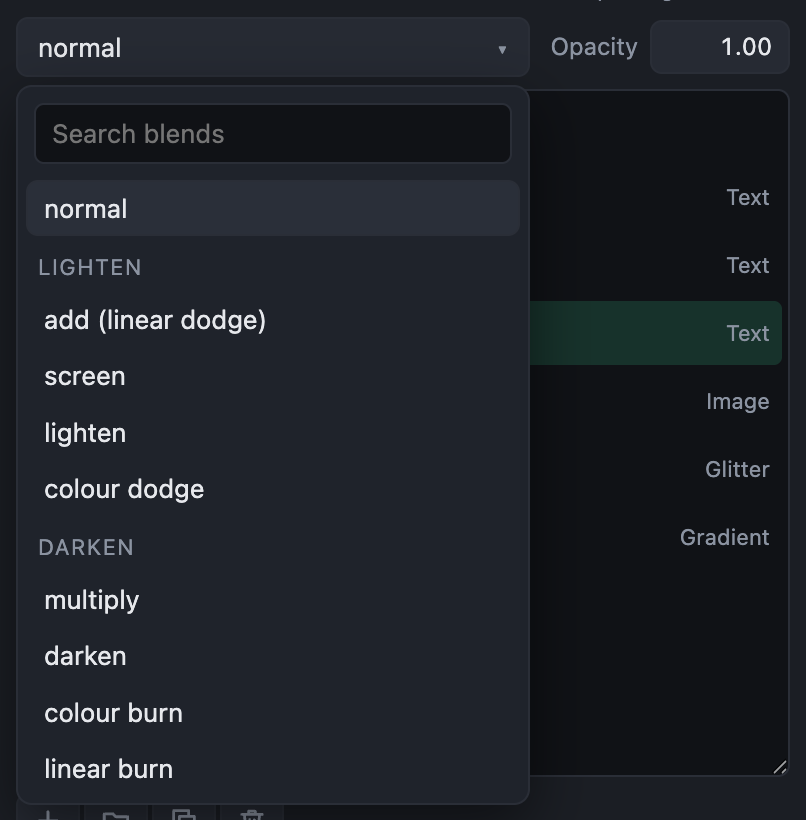

# Blending and groups

## Blending

A layer's **blend** says how it mixes with what is beneath it, as in an image editor. It is chosen above the list of layers, beside the opacity.

Press ↑ or ↓ on the blend to step through them: each is shown on the picture at once. Or open the list and type to find one.

| Blends | What they do |
|---|---|
| normal | The layer covers what is beneath, as far as it is opaque. |
| add (linear dodge), screen, lighten, colour dodge | Lighten: light adds to light. Good for glows, glitter and light leaks over a picture. |
| multiply, darken, colour burn, linear burn | Darken: dark parts darken what is beneath; white leaves it alone. |
| overlay, soft light, hard light | Contrast: lights and darks both push what is beneath. |
| difference, exclusion | Take one from the other, for hard graphic looks. |
| hue, saturation, colour, luminosity | Take only the hue, the richness, the colour or the brightness from the layer. |

A blend can also be chosen by a List field, so that whoever uses the template can switch it.

## Groups

A group holds layers together, to show, hide, fade, blend and move them as one. Its layers are drawn together first, then laid on the picture as one layer.

- **Group** the selected layer with ⌘G (Ctrl+G), or the folder button under the list. **Ungroup** with Shift+⌘G (Shift+Ctrl+G).
- Drag a layer onto a group to put it in.
- Select several layers with ⌘-click (Ctrl-click) or Shift-click to group, delete, duplicate or drag them together.

An effect inside a group changes only the group's own layers, not what is beneath the group: a blur in a group blurs only what is in it.

A group can be moved, turned and sized as one, with **Placement** in its settings, or on the picture: select it in the list, and drag its outline, which is drawn round everything in it. Across and Down say where the middle of what it holds goes; at 50% and 50% it stays where its layers put it. Like any setting, a group's place can follow the music, to nudge a whole block of titles on the kick.
