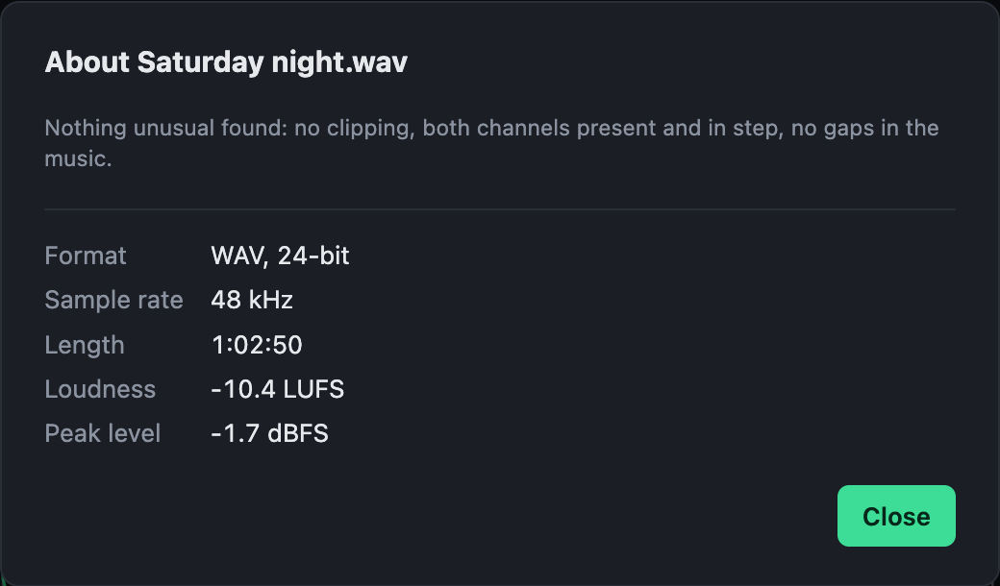

# The check-up

After the analysis, a button next to the file name says **Nothing unusual found**, or how many things there are to know about the recording. Click it for a short report.

It looks for:

- **Clipping**: how much is clipped, and where. Marked in red along the top of the recording.
- **Channels**: one quieter than the other, one silent, or one out of phase. A mono recording.
- **Possible dropouts**: very short gaps the recorder may have left. Marked in white.
- **A very quiet recording.**
- **A sharp upper edge** that MP3 and similar formats leave, even in a file that is lossless now.
- **Mains hum** at 50 or 60 Hz, **rumble** below anything musical, and a waveform that sits **off centre**.

It also lists the format, sample rate, length, loudness and peak.

## Putting the channels right

A channel that is quieter, silent or out of phase can be fixed with one click in the report: evened out, filled from the other side, or flipped. You hear the fix straight away, the levelling works from the fixed sound, and every export carries it. It is kept with the recording, and undone like any change.

> Clipping cannot be undone. A recording made too hot is turned down to match the rest, but what was clipped still sounds clipped.
