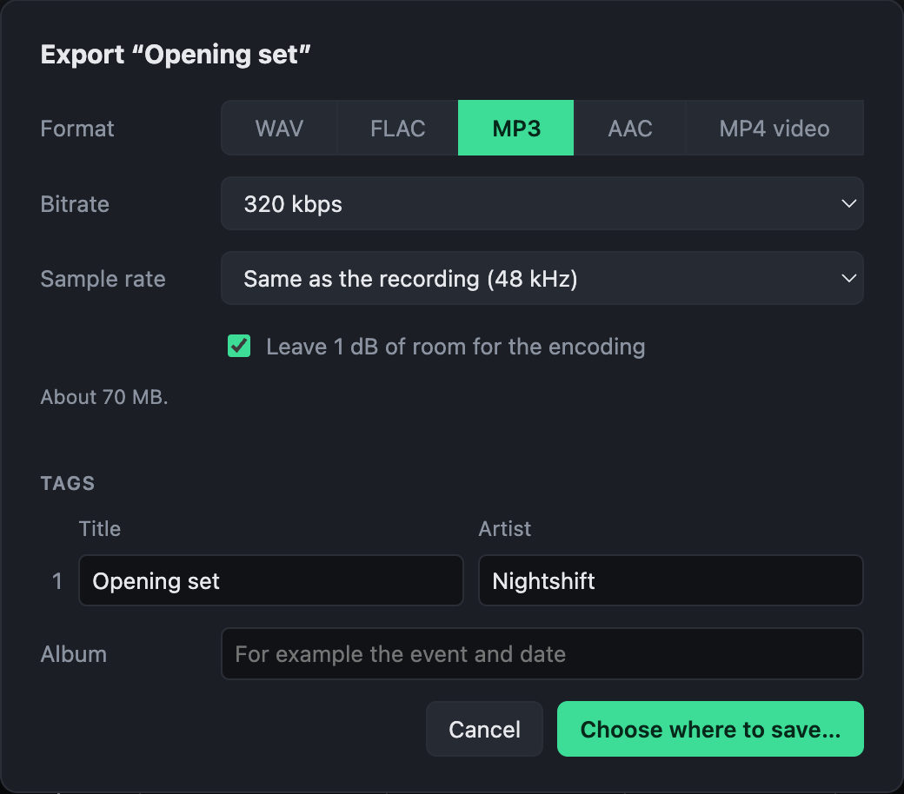

# Exporting audio

**Export mix…** writes the selected mix; **Export all** writes every mix into one folder.

| Choice | What it is |
|---|---|
| Format | WAV or FLAC, lossless; MP3 or AAC, for sharing. |
| Bit depth | For WAV and FLAC: 16-bit, dithered, is the usual choice; 24-bit for further work. |
| Bitrate | For MP3 and AAC. |
| Sample rate | The recording's own, or 44.1 or 48 kHz. |
| Tags | A title and an artist per mix, and an album for the recording. |

The dialog shows roughly how large the files will be, and remembers what you chose. MP3 and AAC exports are made 1 dB quieter by default, as encoding to them raises the peaks.
