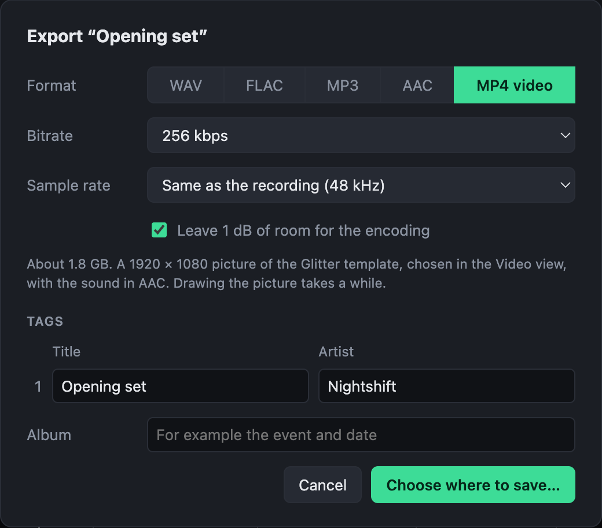

# Exporting video

Choose **MP4 video** in the export dialog to make a video of the mix with its template from the [Video view](video.md).

- Every frame is drawn at 30 frames a second, in the shape chosen in the Video view, with the sound in AAC.
- The tracks become chapters in the file.
- **Export all** makes a video of every mix, each with its own template.
- The first time, the recording is listened to for the beats and the spectrum the template moves to. That takes about as long as its analysis, and is kept.

How long an export takes depends on the template; see [Performance](performance.md).

## Original video

A recording that is a video can also be exported as **Original video**: its own picture with the mastered sound. The picture is copied as it is, not encoded again, so this is about as quick as exporting the sound alone, and loses nothing. A picture an MP4 can hold (H.264, HEVC, AV1) goes into an MP4; any other, such as ProRes, into a MOV.

Players start it on the very frame the mix starts on. At the end, the picture may run a few frames past the sound.
