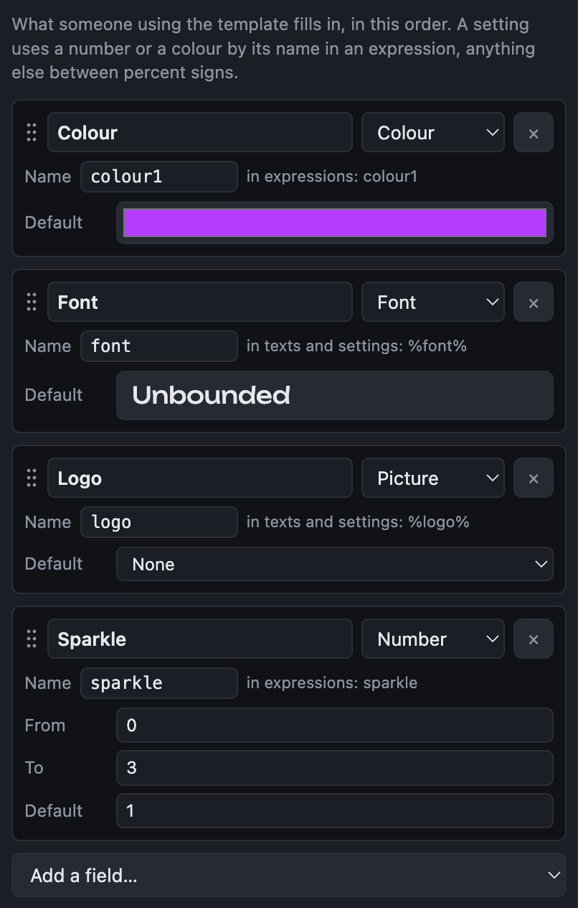
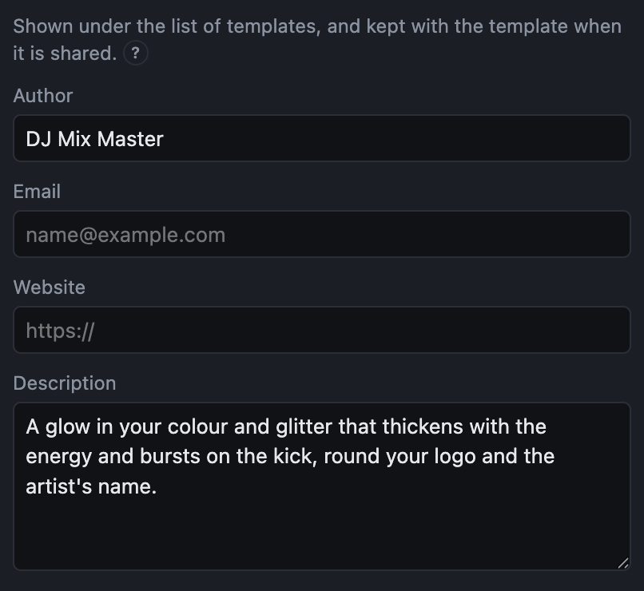

# Fields and the About page

## Fields

Fields are what someone using a template fills in, without editing it: a colour, a logo, the venue. They are made in the editor's **Fields** tab and filled in under the template in the [Video view](video.md).

Each field has a label, shown where it is filled in; a kind; a name, by which the template's settings use it; and a default.

| Kind | Used for | Used in settings as |
|---|---|---|
| Colour | A colour, chosen with a picker | its name in a formula: `colour1`, `lighten(colour1, 0.2)` |
| Number | A slider between two values | its name in a formula: `1 + amount * bass` |
| Text | A line of text | `%name%` in a text layer |
| Picture | A logo or a photo | `%name%` as an image layer's picture |
| Video | A clip, or the recording's own picture | `%name%` as a video layer's video |
| LUT | A look, from those that come with the app, the LUT folder or a .cube file | `%name%` as a LUT layer's LUT |
| Font | A font of the computer's, or one of the app's | `%name%` as a text layer's font |
| List | One of a few words you list | `%name%` in any setting that is a choice, such as a blend |

- **Add a field** with the list at the foot of the tab.
- **Reorder** by dragging a field's card, or click it and press ⌥↑ ↓ (Alt+↑ ↓). Fields are filled in in this order.
- **Remove** with the × button, or click the card and press Backspace. Settings that used it say so.
- **Renaming** a field renames it everywhere the template uses it.

{{shortcuts: Editing a video template}}

## Text variables

Text layers fill in variables written between percent signs, such as `%artist%`, `%mixName%` or `%currentTrack%`. The full list is in the [formula reference](functions.md#text-variables).

## The About page

The **About** tab says who made the template and what it is: an author, an email, a website and a description. It is shown under the list of templates, and kept with the template when it is shared.

