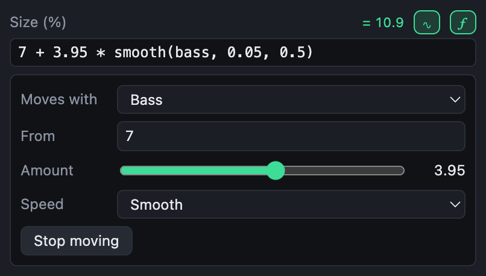
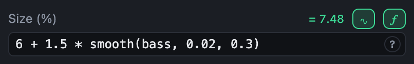

# Moving with the music

Any setting that is a number, a colour or a switch can follow the music. There are two ways: choose what it moves with, or write a formula.

## Moves with

The **∿** button beside a setting opens **Moves with**. Choose what it follows, how far it goes, and how quickly it reacts.



| Moves with | What it follows |
|---|---|
| Bass, Low mids, Mids, Highs | How loud that part of the sound is |
| Level | How loud the whole sound is |
| Energy | Slowly: high in a drop, low in a breakdown |
| Beat | A kick on each beat, falling away before the next |
| A slow wave | Up and down, once every so many seconds |
| Wandering | Drifting at random, as slowly as you choose |

- **From** is the value with nothing moving it.
- **Amount** is how far it goes at the loudest; below zero, it moves the other way.
- **Speed**: Snappy follows every hit, Smooth rounds them off, Slow follows the music over seconds.

**Stop moving** puts the setting back to a plain value. What you choose is written as a formula, so it can be fine-tuned with the ƒ button, and read back into Moves with as long as it keeps that form.

## Formulas

The **ƒ** button turns a setting into a formula, such as:

```
100 + 8 * smooth(bass, 0.02, 0.4)
```

That is 100, plus up to 8 more with the bass, rising in two hundredths of a second and falling over four tenths. While you type, the formula is checked: what is wrong is underlined, with a word on why, and the setting keeps its last good value meanwhile. Beside it is what it comes to right now.



### What a formula is made of

| | Examples |
|---|---|
| Numbers | `0.5`, `2`, `.25` |
| Colours | `#3ddc97`, `#3ddc9780` with see-through, `#fff` |
| Music values | `bass`, `beat`, `energy`, `time`… see the [list](functions.md#music-values) |
| Fields | `colour1`, `amount`: the template's own [fields](fields.md), by name |
| Arithmetic | `+ - * /`, `%` (remainder) and `^` (power) |
| Comparisons | `< <= > >= == !=`, giving 1 or 0 |
| A choice | `condition ? this : that`, such as `portrait ? 12 : 8` |
| Functions | `smooth(…)`, `mix(…)`, `lighten(…)`… see the [reference](functions.md) |
| A constant | `pi` |

A formula gives a number or a colour, depending on what it is made of: `colour1 * 0.5` is a colour, `lightness(colour1)` a number. Colours do arithmetic part by part, red with red and so on. A switch is on when its formula is not 0.

### A few to start from

| Formula | Does |
|---|---|
| `1 + 0.3 * smooth(beat, 0, 0.3)` | Pumps on every kick |
| `100 * smooth(energy, 1, 3)` | Builds up with the energy over seconds |
| `time * 10` | Turns steadily: 10 degrees a second, as a rotation |
| `360 * barPhase` | Turns once a bar |
| `mix(colour1, complement(colour1), sine(beats / 8))` | Swings between a colour and its opposite every eight beats |
| `portrait ? 15 : 9` | A larger size in the vertical shape |
| `progress < 0.1 ? 1 : 0` | On for the first tenth of the mix only |
| `smooth(level, 0.05, 0.5)` | As an opacity: seen as much as the music is loud |
| `progress` | As a shape's Drawn: a progress bar, or a ring that fills, over the whole mix |
| `trackProgress` | The same over each track, starting again at every track marker |
