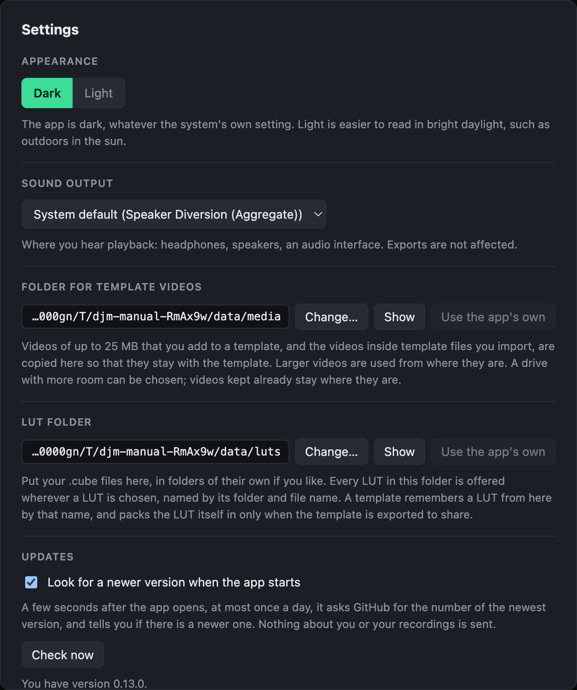

# Installing

Download the installer for your system from the [website](../index.html). Nothing else needs to be installed: the app carries everything it uses, ffmpeg included.

| System | Needs |
|---|---|
| Mac | Apple Silicon (M1 or later), macOS 13 or later |
| Windows | 64-bit Windows 10 or later |
| Linux | 64-bit, Intel or AMD processor |

The installers are not signed, so each system warns about them the first time. On Windows, the [Microsoft Store](https://apps.microsoft.com/detail/9PCL3QKW3G4N) has a copy that needs no such steps and updates itself.

## Mac

1. Open the downloaded disk image and drag DJ Mix Master to Applications.
2. Open it. macOS blocks it the first time.
3. Open **System Settings → Privacy & Security**, scroll down and click **Open Anyway**. From then on it opens normally.

If macOS says the app is damaged, open Terminal and run:

```
xattr -dr com.apple.quarantine "/Applications/DJ Mix Master.app"
```

There is no version for Intel Macs yet.

## Windows

Run the setup file. When **Windows protected your PC** appears, click **More info**, then **Run anyway**.

## Linux

The app is an AppImage: one file that runs as it is.

1. Make it executable: in a terminal, `chmod +x DJ*.AppImage`, or tick "Allow executing" under Properties → Permissions in a file manager.
2. Run it.

If nothing happens, your system lacks FUSE 2, which AppImages need. On Ubuntu 24.04 install it with `sudo apt install libfuse2t64`; on older Ubuntu, `libfuse2`.

## Settings

A few choices belong to the app rather than to a recording. Open them with the gear at the top right, or ⌘, on a Mac (Ctrl+, elsewhere).



- **Appearance**: Dark or Light. The app is dark unless you choose Light, whatever your system's own setting is; Light is easier to read in bright daylight. The choice is kept for next time.
- **Folder for template videos**: where videos added to templates are copied. Choose a drive with more room if you use many.
- **LUT folder**: put your .cube files here, and they are offered wherever a LUT is chosen.
- **Updates**: whether the app looks for a newer version when it starts. This is the only time it contacts anything: it asks GitHub for the newest version's number, at most once a day, and sends nothing about you or your recordings. If there is a newer version, a line at the top of the window says so; nothing is installed for you.
