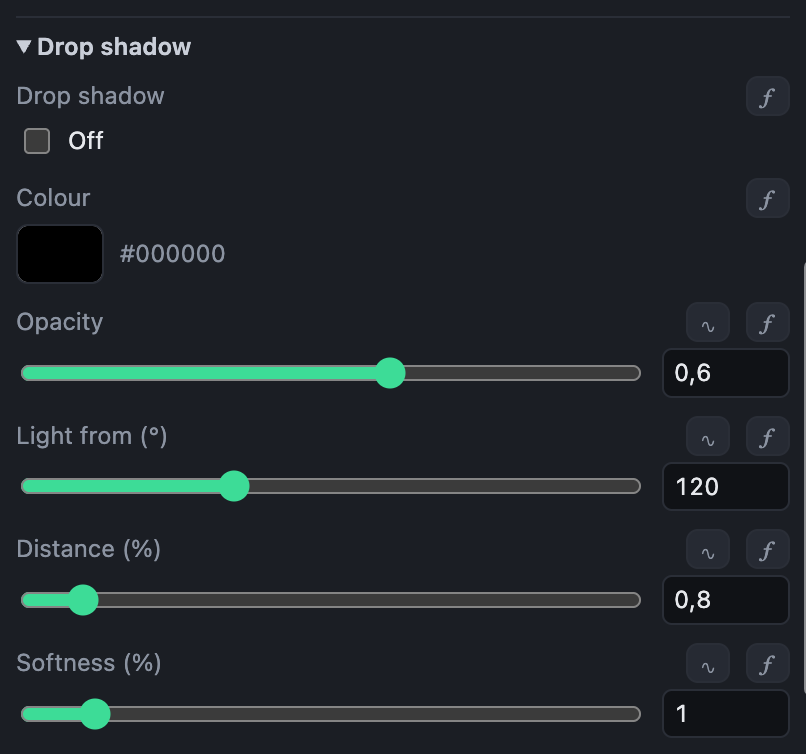

# Layer settings

Besides the settings of its kind, every layer has the ones below. Not every kind uses all of them: an effect that changes the whole picture has no place or size.

## Place, size and timing

Positions are in percent of the picture's width and height, so a template fits any shape. Sizes are in percent of the picture's short side.

Amounts are not percentages but go from 0 to 1, as the [music values](functions.md#music-values) do: an opacity of 1 is fully seen, 0.5 half. Settings that make something stronger or weaker, such as brightness or a glow's strength, are 1 for unchanged, 2 for twice as much. So a music value can be put straight into one: an opacity of `level` follows the loudness.

{{common-settings}}

- **Anchor** says which part of the layer sits at its position: its centre, an edge or a corner.
- **Shown from** and **Shown until, before the end** are in seconds from the start and from the end of the mix: a title can show for the first minute only. **Fade in** and **Fade out** soften those edges.

The settings in **Placement** can also be set on the picture, by dragging the layer's outline and corners.

## Layer styles

Any layer that draws, and any group, can have the styles of an image editor: a drop shadow, a stroke, an outer glow, an inner shadow and an inner glow. Each has its own section in the layer's settings, with a switch to turn it on; a dot beside the heading shows it is on.

The styles are made from the shape of what the layer draws. A drop shadow, an outer glow and a stroke go beneath it; an inner shadow and an inner glow go over it, inside its shape.

{{style-settings}}

- **Light from** is where the light comes from: the shadow falls the other way.
- **Spread** and **Choke** make part of a glow solid before it fades.

Like any setting, a style can move with the music: a glow that pulses with the bass, say.

## Masks

Any layer that draws, and any group, can be used as a mask. Set **Use as a mask** in its **Mask** section: the layer is then not drawn, but decides where the layers above it in its group show. To limit what it masks, put it and those layers in a group. In the list of layers, a mask has a mark, and the layers it shows through have a bracket beside them.

- **By its shape**: what the layer covers shows, the rest is hidden. A shape makes a mask of any outline, which can move and follow the music like the shape itself; text shows a video or a gradient through its letters.
- **By its brightness**: white shows, black hides, grey shows partly. A gradient makes a soft wipe; noise, a dissolve through clouds.
- An effect above a mask changes only what the mask shows: a blur or a glitch in one part of the picture.
- The mask's opacity and fades say how much it shows. Hidden (its eye closed), it masks nothing.

{{mask-settings}}
