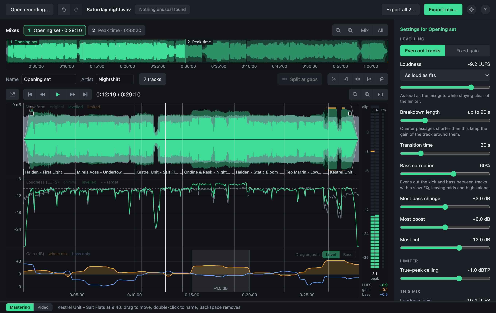

# Listening and levelling

Below the recording is the selected mix: its waveform, its loudness before and after, and the gain being applied. On the right are the settings for how it is levelled.

## Listening

Press **Space** to play. What you hear is the result, through the same limiter the export uses, and every change of a setting is heard at once.

- **Bypass** (the button left of the play controls, or A) plays the recording as it was, for comparison. It pulses while on.
- **J, K and L** run the playhead backwards, stop it, and run it forwards, faster with each press.
- **The meter** beside the curves shows what reaches each speaker, turning red above the ceiling, and how hard the limiter is working.
- **Zoom in** with a scroll or a pinch, down to half a second across the window, where single beats can be seen.

## How it levels

It levels track against track, not moment against moment. A slow gain curve follows how loud each track is at full energy. A quieter passage shorter than the breakdown length is taken for a breakdown and keeps the gain of the track around it, so breakdowns keep their dip.

| Setting | What it does |
|---|---|
| Even out tracks, Fixed gain | Whether the gain follows the tracks, or the whole mix is turned up or down by one amount, as on a mixer. |
| Loudness | How loud the result is. "As loud as fits" goes as loud as it can without leaning on the limiter. Presets aim at a level: Loud (-9 LUFS), Streaming (-14), Podcast or radio show (-16), Broadcast (-23). |
| Breakdown length | Quieter passages shorter than this keep the gain around them. Longer ones count as a quieter track, and are raised. |
| Transition time | How long a change of gain between tracks takes. |
| Bass correction | How much of the difference in bass between tracks is evened out, with a slow EQ. Off at first. |
| Most bass change | The limit on that correction. |
| Most boost, Most cut | How far a quiet track may be raised, and a loud one lowered. |
| True-peak ceiling | The highest level the output may reach. |

## Adjusting by hand

- **Raise or lower a stretch**: drag across the gain lane to mark it, then drag it up or down. The switch in the corner of the lane chooses whether a new stretch changes the whole sound or the bass only.
- **Fades**: drag the small square at either top corner of the waveform inwards.

{{shortcuts: Playback}}

{{shortcuts: The mix, below it}}
