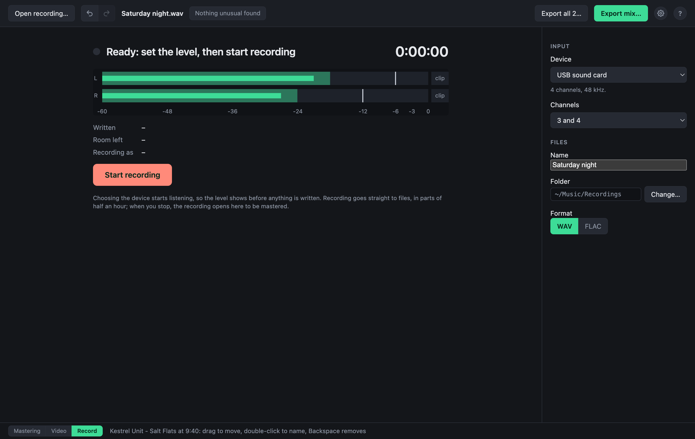

# Recording a night

The app can record the night itself, from a DJ mixer's USB sound card or any other audio input, so that no other program is needed. Click **Record** in the bar at the bottom of the window. Recording has been tried most on macOS; on Windows and Linux it is new, so make a test recording with your own sound card before a night that matters.

## Before you start

- **Device**: the input to record from. Once chosen, it is listened to straight away: the meters show its level, and nothing is written yet, so you can set the level on the mixer before you start. The first time, macOS asks whether DJ Mix Master may use audio inputs. The input is let go again when you leave the Record view without recording.
- **Channels**: which two of the device's inputs become left and right, or one of them on both sides. A mixer's sound card often sends the master on 1 and 2 and the record or booth output on 3 and 4. A device starts on 1 and 2.
- **Name, folder and format**: WAV (24-bit, about 1 GB an hour) plays everywhere; FLAC is just as exact at about half the size. A FLAC recording is written as WAV and each half hour packed into FLAC once it is finished, so that a crash can never leave a part that cannot be read; stopping it takes a few seconds more, while the last part is packed.

## While it records

The meters show the level of each side, with a light that stays lit for a few seconds after a clip, and the time, the size of what has been written and the room left on the drive. The app warns when less than an hour of room is left, and when no sound has come from the input for a few seconds, as when a cable has come out.

The sound goes straight to files, in parts of half an hour, by a small program of the app's own: the rest of the app can be used meanwhile, and the bar at the bottom shows that the recording goes on. The computer is kept from going to sleep.

**Stop recording** asks to be pressed twice, so that a press by mistake does not end the night. The parts then open together as one recording, ready to be split at the gaps and mastered.

## If something goes wrong

- **The app closes or crashes**: the recording goes on. When the app is opened again it shows the recording, still going, and Stop ends it as usual; its level cannot be shown until then.
- **The computer goes down**: everything up to that moment is in the parts. The next time the app starts, it puts the last part right and offers to open the recording.
- **The recording stops by itself**, because the input was unplugged or the drive is full: what was recorded until then is kept, and the Record view offers to open it.
