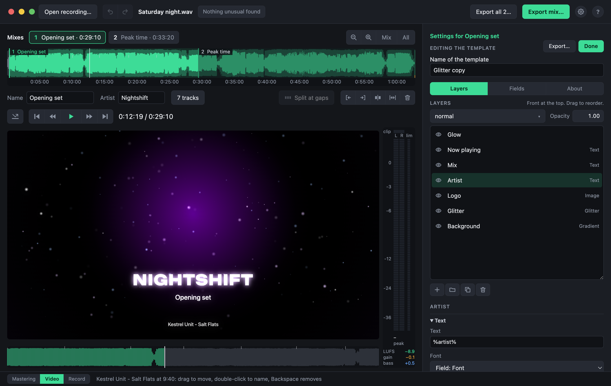
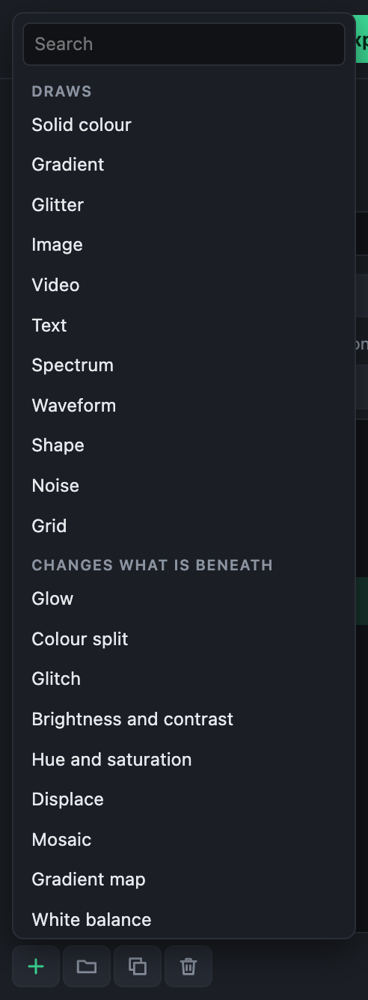
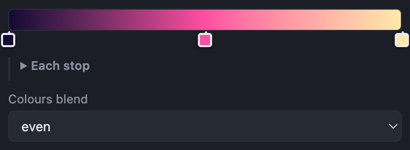

# Editing templates

A template is a stack of layers, drawn from the bottom up: a background, then perhaps glitter, a logo, the artist's name, and effects such as a glow over them. Anything can move with the music.

Click the pencil beside the list of templates to open the editor beside the picture. The templates that come with the app stay as they are: editing one makes a copy of your own. To start from nothing instead, choose **Create new** in the **⋯** menu: an empty template of your own, with no layers, opens in the editor. Every change shows on the picture at once, and is saved as you go.

The editor has three tabs:

- **Layers**: the stack of layers, and the settings of the one selected.
- **Fields**: what someone using the template fills in. See [Fields and the About page](fields.md).
- **About**: who made the template and what it is.

**Done** closes the editor; **Export…** saves the template as a file to share. See [Sharing templates](sharing.md).

## The layers

The list shows the layers with the front one at the top, as in an image editor. Click one to select it; its settings appear below the list, and its [blend](blending-and-groups.md) and opacity above it.

- **Add a layer** with the **+** button, or Shift+⌘N (Shift+Ctrl+N). Type a few letters of its kind and press Return. It goes in front of the selected layer.
- **Hide a layer** with its eye.
- **Reorder** by dragging a layer up or down.
- **Rename** with a double-click.
- **Duplicate** (⌘J, Ctrl+J), **group** (⌘G, Ctrl+G) or **delete** (Backspace) the selected layer, or use the buttons under the list.

There are layers that draw (a gradient, glitter, a picture, text, the spectrum…) and effects that change what is beneath them (a glow, a blur, a LUT…). Each is shown and described in [Layer types](layer-types.md).

## On the picture

Click the picture to select the layer there. Drag its outline to move it, or a corner to resize it; with Shift, it keeps its proportions.

## Settings

A layer's settings are the ones of its kind, then those every layer has: where it is and how big, its layer styles, and when it shows. See [Layer settings](layer-settings.md).

- Drag a number box sideways to change it; with Shift, in finer steps.
- The **∿** button beside a setting makes it [move with the music](formulas.md#moves-with).
- The **ƒ** button turns a setting into a [formula](formulas.md).

### Gradients

A layer with a gradient (a gradient, noise, a spectrum, a shape, a gradient map) shows its colours as a bar, as in a photo editor. Drag a stop's marker to move it, click it to choose its colour, click the bar to add a stop there (five at most), or drag a marker away from the bar to take it out. The last stop stays: a gradient of one stop is a plain colour.

Under the bar, **Each stop** holds every stop's colour and place as ordinary settings, folded away until wanted: open it to make a stop follow the music. A stop whose place follows a formula moves on the bar by itself, and is set there rather than dragged; while any stop follows the music, Each stop stays open.

Wherever a colour is chosen, in a layer's settings, on a gradient's stop or in a field, a click on its swatch or stop opens the colour picker: drag in the square for saturation and brightness, and along the strips for hue and opacity, or type the hex code (`#rrggbbaa` with opacity) or the red, green, blue and opacity values. Opacity 1 is solid, 0 cannot be seen at all; a see-through colour shows over a checkerboard. The eyedropper picks a colour from anywhere on the screen. A click elsewhere or Escape closes the picker.

**Colours blend** says how the colours pass from one stop to the next. *Even* is smooth and true for colours close to each other, and for fades. *Round the colour wheel* keeps colours far apart rich, passing through the hues between them: use it for rainbows, or for a colour and its opposite, which would otherwise meet in grey.

The editor has its own undo while it is open: ⌘Z (Ctrl+Z) undoes changes to the template.

{{shortcuts: Editing a video template}}
