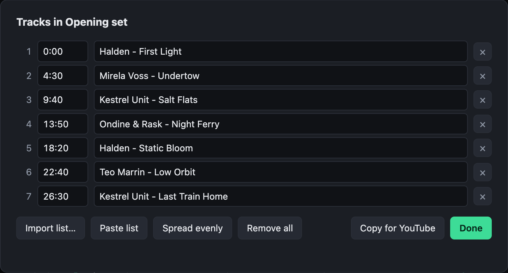

# Tracks and chapters

Marking where each track starts gives the exported files chapters, gives YouTube a track list, and lets a video show the track playing.

## Marking tracks

- Press **M** while the mix plays to mark a track starting at the playhead.
- Drag a marker to move it. Double-click its name to type one in, as _Artist - Title_.
- Backspace removes the marker last clicked.

The **Tracks** button beside the mix's artist lists them all, with their times and names. From there you can:

- **Import a list** from DJ software: a history or playlist exported as M3U8 or text (rekordbox's, for one), or any list of names. A list without times is spread evenly over the mix as a start, shown dashed until each track has been dragged to where it really begins. A list with times, such as `12:30 Artist - Title` on each line, puts them at those times.
- **Paste a list** from the clipboard.
- **Copy for YouTube**: the list with times, for the video's description, where YouTube turns it into chapters. It says so if YouTube will not take it: it wants three tracks at least, each ten seconds or more.

## Where the tracks go

- MP3, AAC and MP4 exports carry them as **chapters**, which many players show.
- A video can show the track playing, with `%currentTrack%` in a text layer. See [Fields](fields.md#text-variables).
