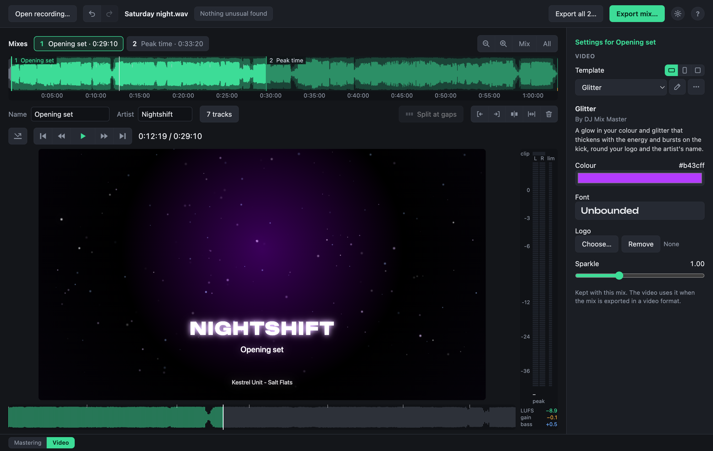
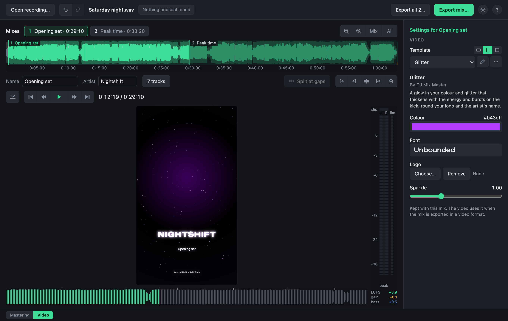

# The Video view

YouTube will not take a mix as sound alone. The **Video** view shows the selected mix as a video: a template that moves to the music, with a few things to fill in, such as a colour, a logo and the artist's name. Switch to it with the bar at the bottom of the window, or Tab.

The recording's timeline and the transport stay as they are; the curves give way to the picture, and the settings to the template's.

## Choosing a template

Pick one from the list under **Template**. These come with the app:

- **Glitter**: a glow in your colour, with glitter that bursts on the kick.
- **Spectrum ring**: the spectrum round your logo.
- **Waveform**: the sound going by.
- **Photo**: a photo of your own behind the names.
- **Original video**: the recording's own picture, for a set that was filmed.

What you choose is kept with the mix, and undone like any other change. The **⋯** button beside the list duplicates, imports, exports or deletes templates, and shows who made one.

## Filling it in

Under the template are its fields: what it asks of you, such as a colour, a logo or a font. What you fill in is kept with the mix. Names come from the mix itself: its name and artist in the Mastering view, and its [tracks](tracks.md).

## The shape

The three small buttons beside **Template** choose the picture's shape:

| Shape | Size | For |
|---|---|---|
| Landscape | 1920 × 1080 | YouTube |
| Vertical | 1080 × 1920 | Phones: Reels, Shorts, TikTok |
| Square | 1080 × 1080 | Feeds |

Every template works in each: positions follow the picture's width and height, and sizes its short side, so a title that fits a landscape picture still fits across a vertical one.

## A recording that is a video

A template's video layer can show the recording's own picture, in step with the music. If the picture runs ahead of the sound or behind it, as some cameras' do, set **Picture delay**: a positive delay shows each frame later.

## Videos that have moved

A template's video clips are found where they were kept. If one has moved, the Video view says so: **Locate…** finds it, and the template's other videos in the same folder with it.
